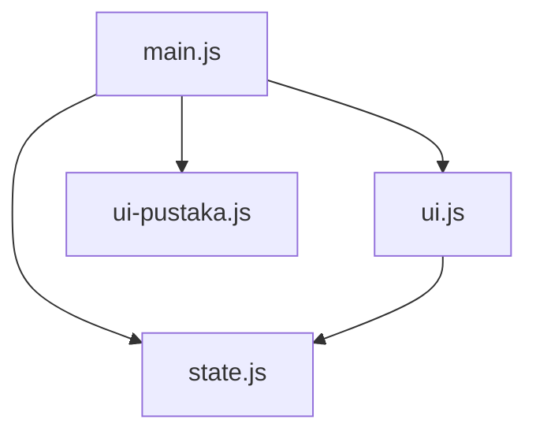

# MODULE_MAP - TaskSplit

Peta modul ES di folder `src/`. Titik masuk: `src/main.js`, dimuat lewat `<script type="module">` di `index.html`.

## Peta import (satu arah, tanpa melingkar)



Versi teks:
```
main.js       -> state.js, ui.js, ui-pustaka.js
ui.js         -> state.js
state.js      -> (tidak mengimpor apa pun)
ui-pustaka.js -> (tidak mengimpor apa pun; memakai `bootstrap` dari skrip CDN)
```

## Tanggung jawab per modul
| Modul | Satu kalimat |
|---|---|
| `main.js` | Titik masuk yang memasang semua event, menjalankan validasi form, dan mengatur bunyi, lalu menghubungkan modul lain. |
| `state.js` | Menyimpan data aplikasi (anggota, tugas, penanda memuat) beserta fungsi mengubahnya, tanpa menyentuh DOM. |
| `ui.js` | Menggambar tampilan, pindah tab, menampilkan atau menghapus pesan error, dan menjalankan animasinya. |
| `ui-pustaka.js` | Pembungkus Bootstrap Toast; satu-satunya berkas yang memanggil JavaScript Bootstrap. |

## Bagian yang belum dimodulkan
- Fitur bunyi (tombol Suara, `mainkanSuara`) masih di `main.js` karena kodenya kecil dan hanya dipakai di sana; dipisah ke modul sendiri bisa dilakukan di sprint berikutnya.
- Validasi form masih di dalam handler `submit` di `main.js`; memisahkannya berarti mengubah alur kode, sedangkan sprint ini menjaga perilaku tetap sama.
- Fungsi bantu `hariIni`, `formatTanggal`, dan `amankan` masih berada di `state.js`; memindahkannya ke modul `util.js` ditunda agar jumlah perubahan tetap kecil.
- Bootstrap dan Google Fonts tetap dimuat lewat tag `<script>` dan `<link>` di `index.html` karena berupa pustaka CDN, bukan kode aplikasi.
- Tidak ada modul penyimpanan karena aplikasi belum memakai localStorage.